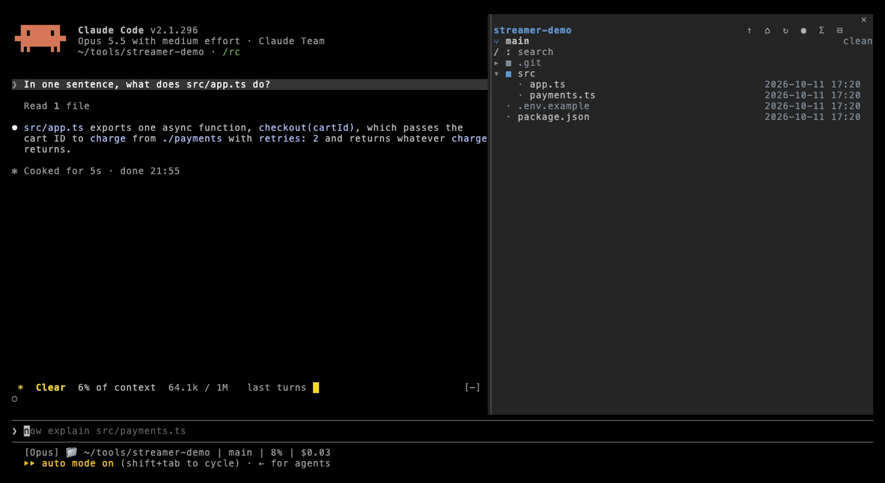
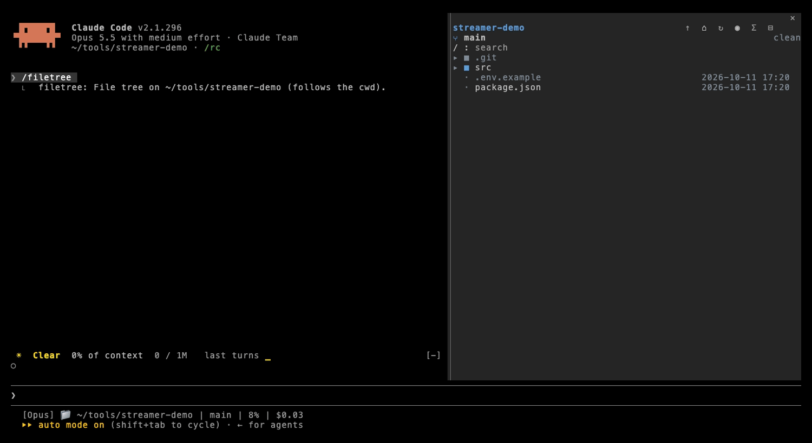
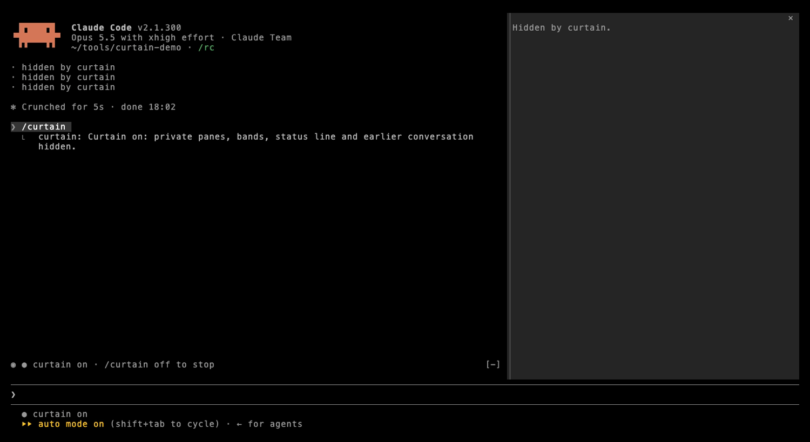
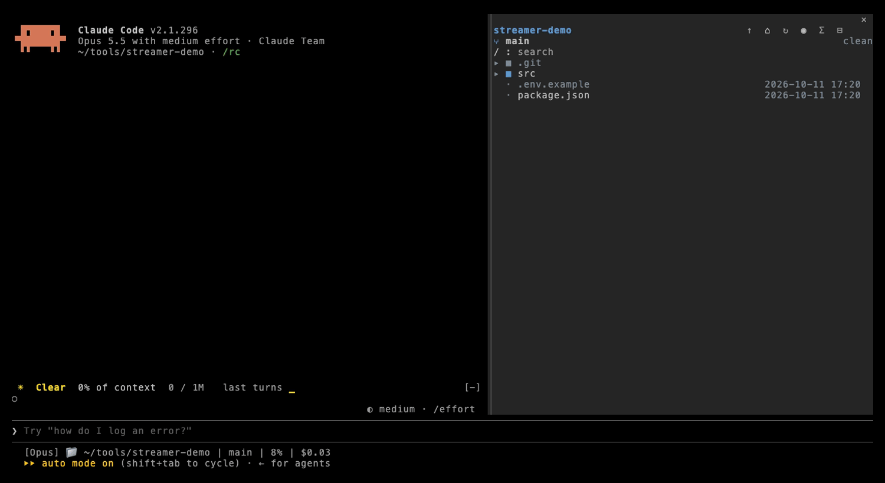

# claude-mods

[Claude Code mods](https://code.claude.com/docs/en/plugins/mods/overview) by huynl-96. Needs Claude Code 2.1.287 or newer.

```
claude plugin marketplace add huynl-96/claude-mods
claude plugin install streamer-mode@claude-mods
```

Run `/reload-plugins` in any open session, or start a new one.

**Then move streamer-mode to the top of your plugin list.** Installed mods run in the order `enabledPlugins` lists them in `~/.claude/settings.json`, and a new install goes last. A mod listed ahead of streamer-mode draws first, so its pane or band can't be covered. Put `"streamer-mode@claude-mods": true` first in `enabledPlugins`, then start a new session. If it isn't first, streamer-mode shows a toast at session start naming the plugin ahead of it.

## streamer-mode

`/streamer` hides what you don't want on a shared screen: the conversation from before you turned it on, your home folder in paths, other mods' panes (a file tree, a browser), the bands above the prompt, and your status line.



| Command | What it does |
|---|---|
| `/streamer` | Turn streamer mode on or off |
| `/streamer on` / `/streamer off` | Set it directly |
| `/streamer settings` | Pick what to hide |

While it's on:

- **Earlier conversation**: only rows added after you turned it on are shown; every other message and tool row collapses to `· hidden in streamer mode`. It errs on hiding: rows from a reload or a resumed session, and anything it can't place, stay hidden. Slash command output is hidden while streamer mode is on, except `/streamer`'s own. Turn it off and everything comes back.
- **Paths** in rows drawn while it's on show your home folder as `~`, so `/Users/you/app.ts` reads `~/app.ts`.
- **Panes** you've marked private stay open but show "Hidden in streamer mode", and come back as they were when you turn it off. A private pane can't be opened while streamer mode is on. Filetree (`filetree`) and Terminal Browser (`browser`) are marked by default.
- **Bands** above the prompt are replaced by one line: `● streamer mode · /streamer off to stop`.
- **Status line** shows only `● streamer mode`, once you add the snippet below.





### Pick your own panes



Open `/streamer settings`. Every pane opened while the mod is loaded is listed there; tick the ones to hide. Mods can't list each other's panes up front, so open a pane once for it to show up. Your choices are saved across sessions.

### Hide your status line

A mod can't redraw a custom status line, so the mod writes `~/.claude/streamer-mode` and your status line script reads it. Add this right after your script reads its input:

```bash
[ -s ~/.claude/streamer-mode ] && { echo "● streamer mode"; exit 0; }
```

Status lines only rerun on session events, so add `"refreshInterval": 2` to `statusLine` in `~/.claude/settings.json` for the switch to show within 2 seconds.

The flag file is shared by every session: turning streamer mode on in one hides the status line in all of them, and it stays on after a restart until you run `/streamer off`.

### Keyboard shortcut (opt-in)

Mods can't add their own shortcut actions, so streamer-mode borrows `app:toggleReplTab`, which is unbound by default and unused while the built-in `/diff` mod is on. Turn on "Keyboard shortcut" in `/streamer settings`, then bind a key in `~/.claude/keybindings.json`:

```json
{ "bindings": [ { "context": "Chat", "bindings": { "ctrl+x s": "app:toggleReplTab" } } ] }
```

While the shortcut is on, a small `○` / `◉` button sits in the band above the prompt; the key presses it.

### Leftover flag reminder

If a session ended with streamer mode on, the next session shows a toast saying the status line flag is still set, so a hidden status line never goes unexplained.

### What it doesn't hide

- New rows from subagents in their own agent view stay hidden while streamer mode is on.
- Names and secrets inside new messages. For that, see [screen-guard](https://github.com/danyuchn/claude-mods).
- Screen sharing can't be detected by a mod, so turning it on is up to you.

### What it can do

`claude plugin validate ./streamer-mode` lists it. It hooks session start, its own command, pane opening, and rows being added, and drawing panes, transcript rows and the band above the prompt. It reads `HOME` and `~/.claude/streamer-mode`, notes the ids of rows added while it's on, writes only that file, and makes no network calls and runs no programs.

## Re-recording the GIFs

The GIFs are recorded with [vhs](https://github.com/charmbracelet/vhs) in a throwaway project, so they show no real files or paths. See [docs/tapes](docs/tapes/README.md).

## Changelog

- **0.2.2**: warn at session start when another plugin is listed before streamer-mode in `enabledPlugins`, since mods listed earlier can't be covered.
- **0.2.1**: a pane keeps its latest title in `/streamer settings`, since a title can name the folder it was opened on.
- **0.2.0**: hide the conversation from before streamer mode, show the home folder as `~` in paths, remind about a leftover status line flag, opt-in keyboard shortcut.
- **0.1.1**: cover private panes instead of closing them, so they come back as they were.
- **0.1.0**: first release.

## License

MIT
